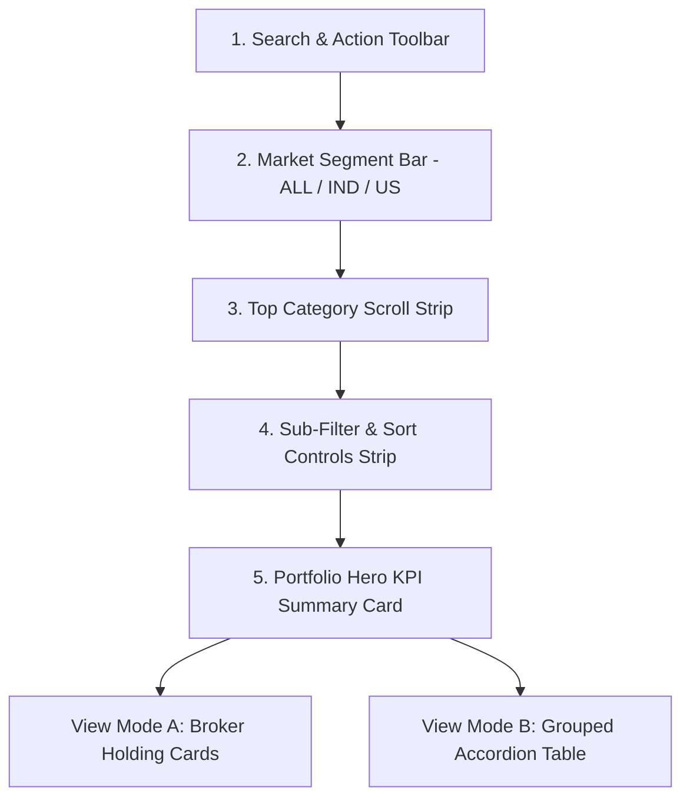
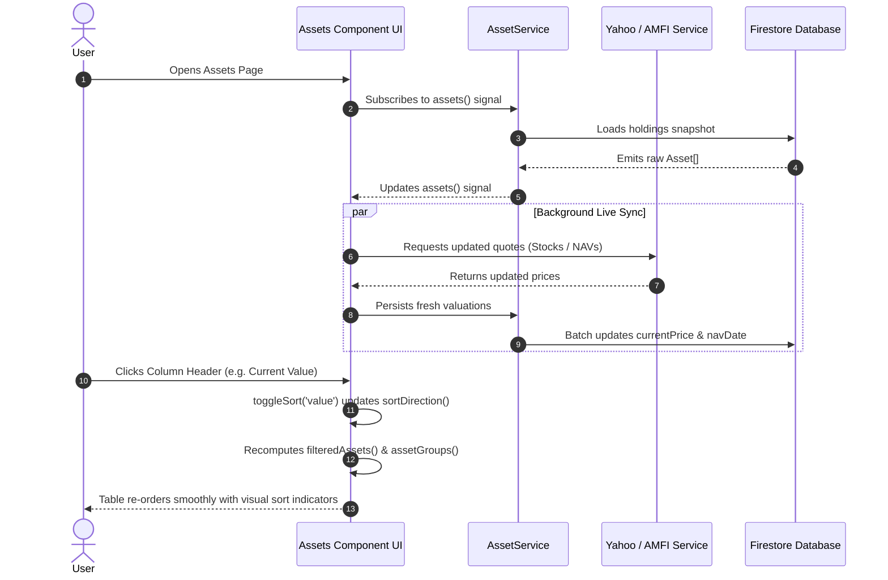

# DM FinTracker — Asset Sections, UI Architecture & Screen Specification

## 1. Executive Summary & System Overview

The **Assets Module** in **DM FinTracker** is an institutional-grade, multi-asset, multi-currency portfolio management engine built with **Angular 20 Standalone Components**, **RxJS**, and **Angular Signals**.

It consolidates all domestic and international wealth into a single unified dashboard, supporting **11 distinct asset categories**, live market price synchronizations, automated broker imports, and interactive sorting and filtering.

### Key Architectural Pillars
- **Dual Currency Architecture**: Seamlessly aggregates Indian Rupee (`₹` / INR) and United States Dollar (`$` / USD) holdings using real-time Google Finance foreign exchange rates (`1 USD ≈ ₹84.xx`).
- **Reactive Signals Pipeline**: Zero-latency UI updates driven by `assets()`, `filteredAssets()`, `assetGroups()`, `sortField()`, and `sortDirection()`.
- **Hybrid Visualization**: Dual-mode rendering supporting both visual **Broker Holding Cards** and a dense **Grouped Accordion Table** with interactive sortable column headers.
- **Privacy & Security**: Client-side parsing (SheetJS) for statements, Firestore document isolation, and one-click numeric privacy masking (`••••••`).

---

## 2. Comprehensive Asset Section Matrix

DM FinTracker models every wealth instrument according to its financial mechanics, clearing schedules, and tax treatments:

| Asset Type (`AssetType`) | Primary Identifier | Valuation Engine | Currency | Emergency Runway (`isLiquid`) | Dedicated UI Features |
| :--- | :--- | :--- | :--- | :--- | :--- |
| **Indian Stocks (`Stock`)** | NSE/BSE Ticker, ISIN | Yahoo Finance (`.NS` / `.BO`) | INR (`₹`) | Non-liquid | Exchange toggle (NSE/BSE), LTP, Day's Gain %, Broker tag |
| **US Stocks (`USStock`)** | NASDAQ/NYSE Ticker | Yahoo Finance (Direct ticker) | USD (`$`) | Non-liquid | Native USD valuation, live INR conversion preview |
| **Mutual Funds (`MutualFund`)** | AMFI Scheme Code, ISIN | AMFI / MFAPI Daily NAV | INR (`₹`) | Liquid (T+2 clearing) | Units count, NAV Date stamp, 1x Daily NAV badge |
| **Fixed Deposits (`FixedDeposit`)** | Account No, Bank Name | Principal + Accrued Interest | INR (`₹`) | Toggleable liquid buffer | Annual interest rate (% p.a.), Maturity date, Premature break flag |
| **Bonds / SGBs (`Bond`)** | 12-char ISIN, Ticker | OpenFIGI + Secondary Price | INR (`₹`) | Non-liquid | OpenFIGI auto-fetch, Coupon rate, Coupon payout schedule, Cashflow projection card |
| **ETFs (`ETF`)** | Exchange Symbol, ISIN | Yahoo Finance Live LTP | INR (`₹`) | Liquid | Index tracking, Day change %, Broker source badge |
| **Gold / Precious Metals (`Gold`)** | Weight in Grams, Purity | Live Bullion Spot Rates | INR (`₹`) | Toggleable | Gram weight, purchase rate per gram, SGB/Physical tag |
| **Real Estate (`RealEstate`)** | Property Title, Address | Fair Market Appraisal | INR (`₹`) | Illiquid | Interactive Google Maps Location Picker, Monthly rental yield |
| **Cash & Bank (`Cash`)** | Bank Name, Account Type | Nominal Balance | INR / USD | 100% Liquid | Core emergency runway pillar, savings interest rate |
| **Crypto (`Crypto`)** | Token Symbol (BTC, ETH) | Live Spot / CoinGecko | USD (`$`) | Liquid | Up to 8 decimal places quantity, Native USD value |
| **Other Custom (`Other`)** | Custom Title | User Appraised Valuation | INR (`₹`) | Custom | Angel investing, unlisted scrips, collectibles, custom notes |

---

## 3. UI Component Architecture & Visual Hierarchy

The Assets interface is organized into five visual tiers designed for clarity, ergonomics, and rapid decision-making:



### 1. Search & Action Toolbar (`.assets-toolbar-row`)
Located at the top of the page, this row standardizes primary actions:
- **Search Input Box**: Real-time filtering across holding name, ticker symbol, broker source, and user notes, with an instant clear button.
- **Select Mode Toggle (`checklist`)**: Enters bulk-management mode with count badges and batch deletion.
- **View Mode Switcher (`table_chart` / `dashboard`)**: Toggles between Holding Cards and Accordion Table views, persisted in `localStorage`.
- **Add Asset Split Button (`+ Add Asset ▾`)**: Primary button opens the universal Add Modal; the dropdown caret enables instant 1-click addition of specific asset types.
- **Import Button (`post_add`)**: Opens the multi-broker parser (Groww, INDmoney, CDSL/NSDL CAS statements).
- **Export Button (`arrow_upward`)**: Generates an authoritative CSV export of current holdings.

### 2. Market Region Segment Bar (`.market-segment-bar`)
Rendered dynamically when the user owns both domestic (Indian) and cross-border (US) holdings:
- `ALL`: Aggregates the entire global portfolio in INR.
- `IND`: Filters down strictly to Indian equities, mutual funds, FDs, and bonds.
- `US`: Filters to US stocks and dollar assets, surfacing native USD subtotals and conversion equivalents.

### 3. Category Horizontal Scroll Strip (`.category-scroll-strip`)
Horizontally scrollable pill tabs showing item counts:
`Overview` &bull; `Indian Stocks` &bull; `US Stocks` &bull; `Mutual Funds` &bull; `Fixed Deposits` &bull; `Bonds` &bull; `ETFs` &bull; `Gold` &bull; `Crypto` &bull; `Real Estate` &bull; `Cash` &bull; `Other`

### 4. Sub-Filter & Sort Controls Strip (`.sub-filter-strip`)
- **Pill Filters**: `All`, `Investments`, `Gainers`, `Losers`.
- **Broker / App Source Filter**: Auto-discovers sources (`Groww`, `INDmoney`, `Zerodha`, `CDSL / NSDL`, `Manual`).
- **Interactive Sort Selector**: Custom select dropdown offering:
  - `Current Value`
  - `Invested Amount`
  - `Returns (P&L)`
  - `Returns %`
  - `Holding Name`
  - `Quantity`
- **Direction Toggle Button**: One-click switch between **Ascending** (`arrow_upward`) and **Descending** (`arrow_downward`).

### 5. Portfolio Hero KPI Card (`.portfolio-hero-card`)
- **Total Portfolio Valuation**: Prominently displayed with a toggleable privacy eye (`••••••`).
- **Multi-Currency Live Indicator**: Shows real-time converted INR equivalent for US assets.
- **Screen-Aware Refresh Button (`.refresh-all-btn`)**:
  - Dynamically updates **only the assets displayed on screen** (`filteredAssets()`).
  - When filtering or viewing **US Stocks**, it initiates API calls strictly for US tickers (Google Finance / Yahoo Finance), without requesting quotes for Indian equities or mutual funds.
  - When filtering **Mutual Funds**, it queries only AMFI NAVs without calling stock APIs.
  - When filtering **Indian Stocks**, it requests only domestic exchange feeds.
  - Non-market assets (Cash, FDs, Real Estate, Bonds) are automatically bypassed from market quote calls.
  - Tooltip dynamically shows the active scope (e.g. *"Refresh US Stock prices"* or *"Refresh visible prices on screen"*).
- **Metric Sub-Cards**:
  - `Total Invested Capital`
  - `Overall Returns (P&L)` with percentage multiple
  - `Day's Gain / Today's P&L`
  - `Total Assets Count`

---

## 4. Dual View Modes Walkthrough

### View Mode A: Broker Holding Cards (`.holdings-cards-list`)
The Card View is designed for visual impact and quick portfolio health checks.

```
+-----------------------------------------------------------------------+
| [Icon] RELIANCE INDUSTRIES LTD                  [Groww] [NSE: RELIANCE]|
| Oil & Gas Conglomerate                                                |
+-----------------------------------------------------------------------+
|  QUANTITY          AVG BUY PRICE       CURRENT LTP        INVESTED    |
|  25 shares         ₹2,840.00           ₹3,010.50          ₹71,000.00  |
+-----------------------------------------------------------------------+
|  CURRENT VALUATION                     TOTAL RETURNS (P&L)            |
|  ₹75,262.50                            +₹4,262.50 (+6.00%) [PROFIT]   |
+-----------------------------------------------------------------------+
|  Actions: [Sync Price 🔄]             [Edit ✏️]             [Delete 🗑️]|
+-----------------------------------------------------------------------+
```

#### Card Elements:
1. **Asset Header**: Type-colored Material Icon, Full Company Name, Broker Source Badge (e.g. `Groww`, `Zerodha`), and Ticker / ISIN.
2. **Metrics Grid**: Four-column layout displaying Quantity, Weighted Average Purchase Price, Live Market Price (LTP), and Total Invested.
3. **Valuation & Returns Box**: High-contrast valuation highlight paired with a color-coded Return Pill (Emerald Green for profit, Crimson Red for loss).
4. **Action Bar**:
   - `Sync`: Force-refreshes the individual asset's live market price or official NAV.
   - `Edit`: Opens the pre-filled edit modal.
   - `Delete`: Danger action triggering the deletion confirmation modal.

---

### View Mode B: Grouped Accordion Table (`.accordion-container`)
The Table View is optimized for dense financial auditing and institutional analysis.

#### Column Header Bar (`.table-header-row`):
Every column header is an interactive sort trigger with directional icons:

```
[ HOLDING NAME ⇅ ] [ ALLOC / QTY ⇅ ] [ INVESTED ⇅ ] [ CURRENT VALUE ⇅ ] [ RETURNS / P&L ⇅ ] [ ACTIONS ]
```

#### Parent Category Accordion Row (`.accordion-parent`):
- Category Icon & Title (e.g., `Mutual Funds`, `Indian Stocks`, `US Stocks`).
- Assets counter pill & FX rate badge (e.g., `1 USD ≈ ₹84.35` or `1× Daily NAV`).
- Visual Allocation Bar showing percentage weight within the total portfolio.
- Category Total Invested & Total Current Valuation.
- Category Net Gain amount and return percentage.
- Expand / Collapse indicator (`expand_more` / `expand_less`).

#### Child Asset Row (`.accordion-child`):
When expanded, every individual asset under that category renders with exact column alignment:
- **Child Name**: Indented name, symbol, sub-type tags (e.g., `7.25% p.a. · Mat: 2027-10-15` for FDs).
- **Alloc / Qty**: Precise unit holdings up to 4 decimal places.
- **Invested**: Total capital deployed and per-unit purchase cost.
- **Current Value**: Live valuation, per-unit market price, and NAV publication date stamp.
- **Returns / P&L**: Profit/loss amount and percentage.
- **Child Actions**: Individual Price Sync, Edit, and Delete buttons.

---

## 5. Add / Edit Asset Modal Specification

The Add Asset Modal dynamically reconfigures its inputs based on the selected `AssetType`:

```
+-------------------------------------------------------------------+
| Add Asset                                                     [X] |
+-------------------------------------------------------------------+
| Asset Name *                                                      |
| [ e.g. HDFC Bank Ltd / UTI Nifty 50 Index Fund                  ] |
+-------------------------------------------------------------------+
| Type *                             Currency                       |
| [ Indian Stocks                 ▾] [ INR (₹)                   ▾] |
+-------------------------------------------------------------------+
| (Conditional Fields based on Type selected above)                 |
|                                                                   |
| [If Stock / ETF]: Search Symbol [NSE | BSE]                       |
| [If Bond]:        Bond ISIN Identifier [OpenFIGI Fetch Button]    |
|                   Coupon Rate %, Maturity Date, Payout Schedule   |
| [If FD]:          Interest Rate %, Maturity Date, Liquid Buffer   |
| [If RealEstate]:  Interactive Google Map Location Picker          |
+-------------------------------------------------------------------+
| Quantity / Units *                 Buy Price / Avg NAV *          |
| [ 50                             ] [ ₹1,650.00                  ] |
+-------------------------------------------------------------------+
| Current Price / NAV *              App Source                     |
| [ ₹1,720.00                      ] [ Groww                     ▾] |
+-------------------------------------------------------------------+
| Notes (Optional)                                                  |
| [ Long-term core allocation                                     ] |
+-------------------------------------------------------------------+
| [Cancel]                                            [Add Asset]   |
+-------------------------------------------------------------------+
```

### Type-Specific Dynamic Fields

#### 1. Indian Stocks & ETFs
- **Symbol Auto-Suggest**: Interactive search querying official NSE and BSE symbol databases.
- **Exchange Toggle**: Switch between **NSE** and **BSE** lookup.
- **ISIN Capture**: Automatically captures national ISIN upon symbol selection.

#### 2. Corporate & Government Bonds
- **OpenFIGI ISIN Auto-Fetch**: Enter a 12-character ISIN (e.g. `IN0020230085`) and click **Fetch** to automatically populate Bond Name, Category (G-Sec, Corporate, SGB, Tax-Free), Coupon Rate, and Maturity Date.
- **Payout Frequency**: Supports Semi-Annual, Annual, Quarterly, Monthly, or Cumulative.
- **Auto-Calculated Payout Schedule**: Automatically predicts the exact calendar dates when interest credits hit the bank.
- **Live Cash Flow Projection Card**: Instantly computes Annual Interest Income and Cycle Payout amount before saving.

#### 3. Fixed Deposits (FD)
- **Interest Rate (% p.a.)**: Annual yield percentage.
- **Maturity Date**: Expected redemption date.
- **Emergency Runway Liquidity Checkbox**: Marks whether the deposit can be prematurely liquidated to safeguard emergency runway calculations.

#### 4. Real Estate
- **Interactive Location Picker**: Integrates with Google Maps Platform / Places API to store formatted addresses and geo-coordinates.

---

## 6. Bulk Selection & Deletion Warning Modal

To prevent accidental data loss while allowing efficient cleanup, DM FinTracker provides an institutional batch deletion workflow:

```
+-------------------------------------------------------------------+
|                           [ ⚠️ Warning ]                           |
|                        Delete 3 Holdings                          |
|         Are you sure you want to permanently delete these?        |
+-------------------------------------------------------------------+
| Impact Summary:                                                   |
| • Total Invested Capital to be removed: ₹1,45,000                 |
| • Current Market Valuation impacted:   ₹1,62,400                 |
+-------------------------------------------------------------------+
| Selected Holdings:                                                |
| 1. Reliance Industries Ltd (25 shares) — ₹75,262.50               |
| 2. HDFC Bank Ltd (50 shares)           — ₹86,000.00               |
| 3. Parag Parikh Flexi Cap Fund         — ₹1,137.50                |
+-------------------------------------------------------------------+
| This will remove them from portfolio tracking, live price updates,|
| and net worth calculations. Historical transactions remain safe.  |
+-------------------------------------------------------------------+
| [Cancel]                                       [Confirm Delete 🗑️]|
+-------------------------------------------------------------------+
```

- **Atomic Batch Deletion**: Uses Firestore `writeBatch` in chunks of 500 documents to eliminate UI lockups and snapshot listener storms.
- **Visible-Only Selection**: Multi-select applies strictly to visible filtered holdings, preventing unintended deletion of hidden assets.

---

## 7. State Management & Data Flow Architecture



---

## 8. Summary of Standardized Actions

Across the Assets module and companion financial pages (Transactions, SIP, EMI):
- **Add**: Standardized primary high-contrast button (`.btn-primary.btn-sm.add-main-btn`) with `+` icon.
- **Import**: Standardized secondary button (`.btn-ghost.btn-sm.action-tool-btn`) with `post_add` icon.
- **Export**: Standardized secondary button (`.btn-ghost.btn-sm.action-tool-btn`) with `arrow_upward` icon.
- **Delete**: Standardized danger action (`.btn-delete`) with red hover glow and `delete` icon.
- **Sort**: Standardized `.sortable-th` and `.sortable-col` with directional arrow indicators (`arrow_upward` / `arrow_downward`).
